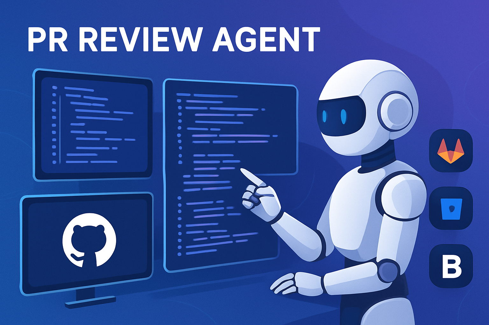

# PR Review Agent
An AI-powered agent capable of reviewing pull requests across multiple git servers (GitHub, GitLab, Bitbucket). The agent analyzes code changes and provides constructive feedback for improvements.



## 🌟 Features

- **Multi-Platform Support**: Compatible with GitHub, GitLab, and Bitbucket
- **AI-Powered Analysis**: Intelligent feedback using Hugging Face Mistral model for code structure, standards, and potential bugs
- **Quality Scoring**: Comprehensive scoring system for code quality assessment
- **Inline Comments**: Precise feedback with line-specific suggestions
- **CI/CD Integration**: Seamless integration with CI/CD pipelines for automated pre-merge reviews

## 📋 Requirements

- Python 3.8+
- Hugging Face API token (for AI-powered analysis)
- Git platform access tokens (for private repositories)

## 🚀 Quick Start

### Installation

1. Clone the repository:
   ```bash
   git clone https://github.com/yourusername/pr-review-agent.git
   cd pr-review-agent
   ```

2. Create and activate a virtual environment:
   ```bash
   python -m venv venv
   source venv/bin/activate  # On Windows: venv\Scripts\activate
   ```

3. Install dependencies:
   ```bash
   pip install -r requirements.txt
   ```

4. Set up environment variables:
   ```bash
   export HF_TOKEN="your-huggingface-token"
   export GITHUB_TOKEN="your-github-token"  # Optional, for private repos
   ```

### Running the Application

1. Start the Flask server:
   ```bash
   python src/main.py
   ```

2. Open your browser and navigate to:
   ```
   http://localhost:5000
   ```

## 🔍 Usage

### Web Interface

The web interface provides an easy way to analyze pull requests:

1. Select the Git platform (GitHub, GitLab, or Bitbucket)
2. Enter the repository URL and PR number
3. Optionally provide a GitHub token for private repositories
4. Click "Analyze Pull Request"

### API Endpoints

The application provides RESTful API endpoints for integration:

#### Analyze Pull Request

```
POST /api/review/analyze
```

Request body:
```json
{
  "platform": "github",
  "repo_url": "owner/repo",
  "pr_number": 123,
  "github_token": "optional-token"
}
```

Response:
```json
{
  "success": true,
  "pr_info": { ... },
  "review_result": {
    "quality_score": { ... },
    "feedback_items": [ ... ],
    "recommendations": [ ... ]
  }
}
```

#### Health Check

```
GET /api/review/health
```

Response:
```json
{
  "status": "healthy",
  "services": {
    "github_connector": "available",
    "ai_analyzer": "available"
  }
}
```

## 🧩 Architecture

The PR Review Agent follows a modular architecture:

- **Git Platform Connectors**: Interface with GitHub, GitLab, and Bitbucket APIs
- **AI Analysis Engine**: Analyzes code changes using Hugging Face Mistral model
- **Review Interface**: Web dashboard and API endpoints
- **Data Models**: Structured representation of PRs and review results

## 🛠️ Development

### Project Structure

```
pr_review_agent/
├── src/
│   ├── models/
│   │   ├── pull_request.py
│   │   └── review_result.py
│   ├── connectors/
│   │   ├── github_connector.py
│   │   ├── gitlab_connector.py
│   │   └── bitbucket_connector.py
│   ├── analyzers/
│   │   └── ai_analyzer.py
│   ├── routes/
│   │   └── review.py
│   ├── static/
│   │   ├── index.html
│   │   └── script.js
│   └── main.py
├── tests/
│   └── test_app.py
├── requirements.txt
└── README.md
```

### Running Tests

```bash
python test_app.py
```

## 📝 License

This project is licensed under the MIT License - see the LICENSE file for details.

## 🙏 Acknowledgements

- Hugging Face for providing the Mistral model and inference API
- GitHub, GitLab, and Bitbucket for their comprehensive APIs
- CodeMate Hackathon for the inspiration

